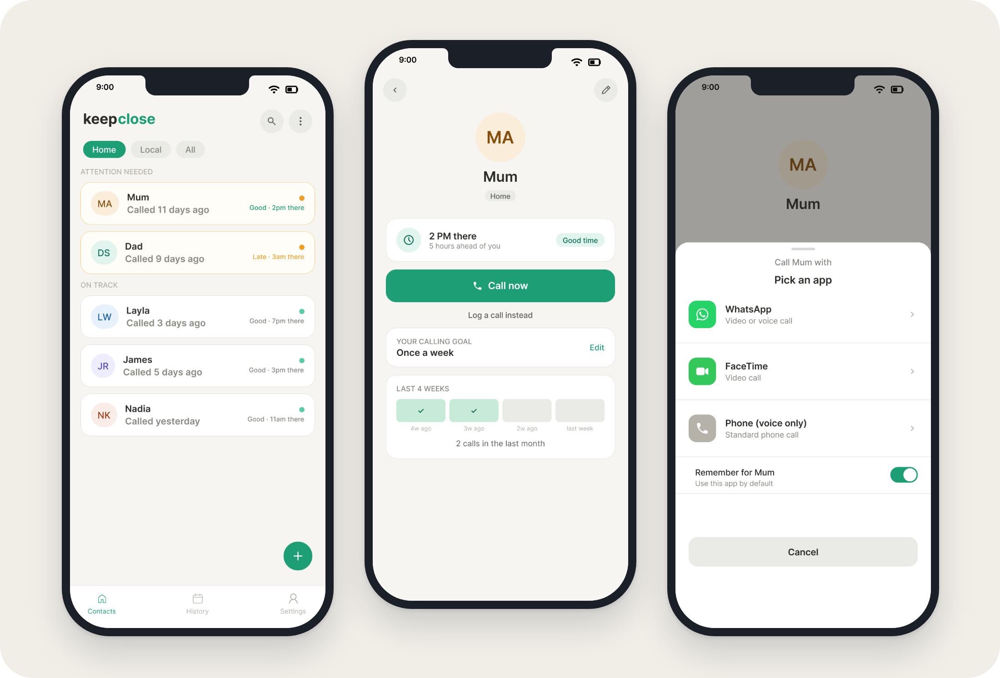
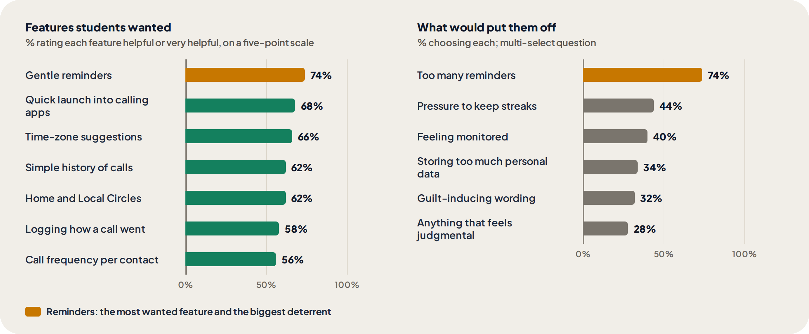

# keepclose

**A mobile app that helps international students mitigate homesickness and loneliness by supporting routine-based calls with family and friends.**

**[View prototype (Figma)](https://www.figma.com/proto/0B8tftOfGUGLy5E3CEovnf/CSC3094--Prototype?node-id=5-2&p=f&t=t9PPbauTl4bC6bGU-1&scaling=scale-down&content-scaling=fixed&page-id=0%3A1&starting-point-node-id=5%3A2)**

**[Read the case study (PDF)](Ayoub-Aldawood-keepclose-Case-Study.pdf)**

<em>Selected screens: Contacts, Contact Detail, and the call launch sheet</em>

| Role | Methods | Tools |
|---|---|---|
| Research, design, prototyping and evaluation | Survey (50 students); scenario-based walkthroughs (10 students) | Figma, Google Forms |

Regular calls with family and friends help international students cope with homesickness and loneliness, but time zones, study demands and daily responsibilities make those calls hard to keep up. To address this in my BSc dissertation at Newcastle University, I surveyed 50 international students, designed and prototyped keepclose in Figma, and evaluated it through scenario-based walkthroughs with 10 students. All ten completed every journey with no failed steps, and the design's restraint (no streaks, scores or automatic tracking) drew the strongest endorsement. The full dissertation is available on request.

## The Central Design Risk

Gentle reminders were the most wanted feature, yet too many reminders was the most common reason to avoid an app like this, both at 74%. keepclose is designed around that tension: reminders stay rare and adjustable, and nothing turns keeping in touch into a score.

<em>Survey of 50 international students: features rated helpful (left) and what would put them off (right)</em>

## What's in the Case Study

- Final design, annotated journey by journey
- What the design avoids on purpose
- Problem and user research
- From findings to requirements
- Evaluation and findings
- Limitations and next steps
- Reflection

## Skills Demonstrated

User research · Survey design · Requirements analysis · Information architecture · Interaction design · UX writing · Wellbeing-supportive design · Scenario-based evaluation · Prototyping · Figma
